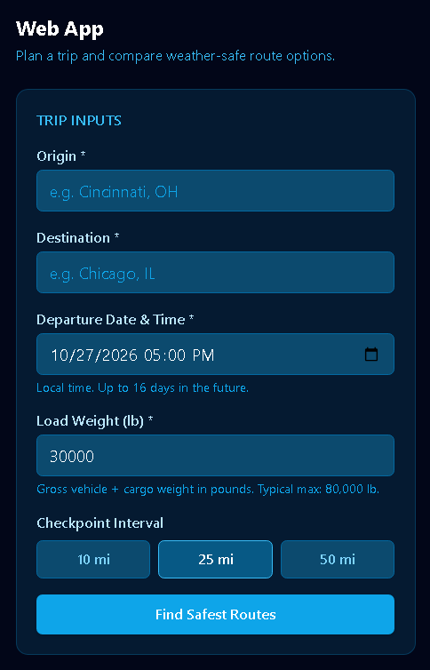
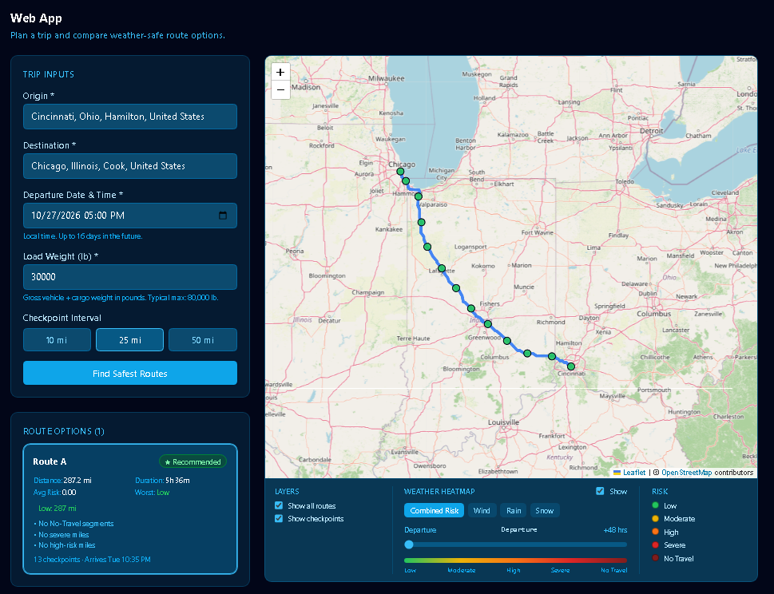
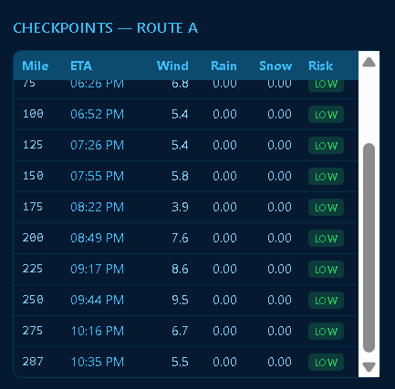
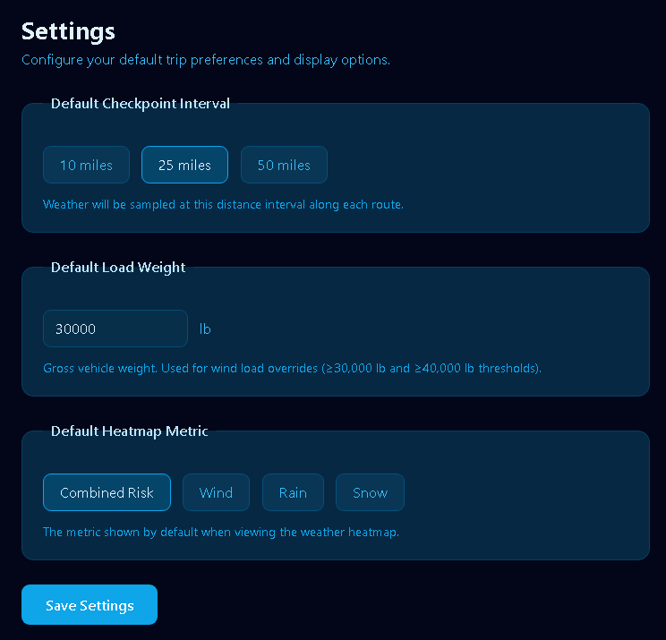

# Dirmile

<p align="center">
  <strong>Weather-aware truck routing — pick the safest corridor, not just the shortest one.</strong><br>
  Enter origin, destination, departure time and load weight. Get route options graded by
  wind / rain / snow risk <em>at the moment you'll actually be there</em>, with a recommended
  route and a 0–48 h forecast heatmap along the corridor.
</p>

<p align="center">
  
  
  
  
  
  <a href="https://github.com/sponsors/S-V-J"></a>
</p>

---

## Contents

- [Live demo](#live-demo) · [Run it yourself in 4 commands](#run-it-yourself-in-4-commands)
- [Features](#features) · [Architecture](#architecture) · [Tech stack](#tech-stack)
- [The `dirmile` CLI](#the-dirmile-cli) · [Configuration](#configuration) · [API reference](#api-reference)
- [Risk model](#risk-model) · [Route recommendation](#route-recommendation)
- [Testing](#testing) · [Hosting & Cloudflare Tunnel](#hosting--cloudflare-tunnel) · [PWA](#pwa)
- [Screenshots](#screenshots) · [Walkthrough](#walkthrough)
- [Known limitations](#known-limitations--honest-notes) · [Security notes](#security-notes)
- [Attribution & credits](#attribution--credits) · [Disclaimer](#disclaimer) · [License](#license)
- [About the author](#about-the-author) · [Sponsor](#sponsor)

---

## Live demo

The application runs on a local WSL2 Linux host and is exposed to the public internet through a
**Cloudflare Tunnel** — outbound-only, so no inbound ports are ever opened on the host.

Because a *Quick* Tunnel mints a new random hostname on every process start, the public URL is
printed by `./dirmile start` and is shared alongside this repository rather than hard-linked here
(where it would rot within a day). A **named** tunnel with a stable hostname is fully configured
and registered at the Cloudflare edge; it goes live as soon as its zone delegation propagates.

Either way, the fastest way to see Dirmile is to run it — it takes about two minutes and needs no
API keys, no accounts, and no cloud bill.

## Run it yourself in 4 commands

```bash
git clone https://github.com/S-V-J/dirmile.git && cd dirmile

python3 -m venv venv && source venv/bin/activate
pip install -r requirements.txt

cd Frontend && npm install && npm run build && cd ..

cp .env.example .env
python -c "import secrets; print('SECRET_KEY=' + secrets.token_urlsafe(50))"   # paste into .env

./dirmile start        # prints the local URL and the public tunnel URL
```

Then open the printed URL, register, and plan a trip. To verify the suite:

```bash
python -m pytest -q    # 168 passed
```

**Prerequisites:** Python 3.14, Node 20+, `cloudflared` on `PATH` (for the public URL only — the
app runs fine on its local URL without it).

## Features

**Inputs** — origin and destination (typeahead autocomplete, ranked by population), departure
date/time, load weight in pounds, checkpoint interval (10 / 25 / 50 miles).

**Processing**

- Requests up to **3 route alternatives** from OSRM, with full geometry, distance, duration and
  turn-by-turn steps.
- Estimates **arrival time at each checkpoint** by walking OSRM step durations forward from
  departure — so weather is sampled *when the truck will be there*, not at departure.
- Samples **hourly wind, rain and snow** from Open-Meteo along the corridor in batched requests.
- Classifies every checkpoint against fixed wind / rain / snow thresholds, then applies
  **load-based overrides** (a 40,000 lb truck meets "Severe" where an empty one meets "High").
- Aggregates checkpoint risk into **per-band mileage** (low / moderate / high / severe / no-travel)
  and a mileage-weighted average risk score.
- **Ranks routes** by a deterministic 8-level key and marks the winner, with human-readable reasons.

**Output** — all routes drawn on one Leaflet map with distinct colours, risk-coloured checkpoint
markers with detail popups, route summary cards, a sortable checkpoint table, a **0–48 h weather
heatmap** along the corridor with a forecast slider and metric switch (combined risk / wind / rain /
snow), layer toggles, and a risk legend.

## Architecture

A **single Django process** serves the API, the admin, the built React SPA and the proxied map
tiles from one origin. That is deliberate: same-origin means session cookies need no CORS
exceptions, the service worker can cache tiles normally, and every tile request becomes visible in
the application log instead of disappearing into the browser's cross-origin network layer.

```text
Browser (React PWA)
   │  same-origin
   ▼
Django
 ├── /api/health/ · /api/auth/* · /api/plans/* · /api/places/* · user + settings
 ├── /tiles/{z}/{x}/{y}.png ──► tile.openstreetmap.org   (bounds-checked proxy)
 ├── /assets/* · /icons/* · /sw.js · /* (SPA fallback)   via WhiteNoise + frontend view
 │
 ├── plans/services.py
 │     ├── routing/osrm.py ──────► OSRM demo (alternatives=3)
 │     ├── core/geo.py ──────────► corridor sampling, mile markers, geometry decode
 │     ├── routing/eta.py ───────► step-wise ETA from departure
 │     ├── weather/services.py ──► Open-Meteo batched hourly forecast
 │     ├── weather/risk.py ──────► thresholds + load overrides  (pure, no I/O)
 │     └── plans/recommendation.py ► aggregate mileage bands, rank, explain
 └── SQLite: TripPlan · RouteOption · Checkpoint · HeatmapPoint
```

**Cache policy** (kept in sync with `Backend/core/test_frontend.py`):

| Path | Headers | Why |
|---|---|---|
| `/assets/*`, `/workbox-*` | `public, max-age=31536000, immutable` | filename carries the content hash |
| `/tiles/*` (200) | `public, max-age=604800, immutable` | OSM tiles are immutable |
| `/tiles/*` (204 blank) | `no-store` | a transient upstream hiccup must never punch a week-long hole in the map |
| `/sw.js`, `/index.html` | `no-cache, no-store, must-revalidate` | the browser must always see the newest build |

**Tile proxy** — `/tiles/` forwards to OpenStreetMap with a single honest `User-Agent` identifying
Dirmile, as the OSM tile usage policy asks, instead of one per visitor. It is bounds-checked at
every layer (extension whitelist, zoom ≤ 19, tile coordinates within `2^z`) so it can never be
repurposed as an open crawler. Upstream failure returns a `204` blank rather than a `500`, so one
flaky tile cannot break the map. Nine regression tests cover the happy path, HEAD support,
uppercase extensions, all three guard rejections, and both no-store blank paths.

## Tech stack

| Layer | Choice |
|---|---|
| Backend | Python 3.14 · Django 6.1 · Django REST Framework 3.18 · WhiteNoise · requests |
| Frontend | React 18 · TypeScript (strict) · Vite 6 · Tailwind CSS · React Router |
| Maps | Leaflet · leaflet.heat · OpenStreetMap raster tiles |
| Data | Open-Meteo Forecast + Geocoding APIs · OSRM routing · SQLite |
| PWA | vite-plugin-pwa / Workbox (generateSW) |
| Testing | pytest · pytest-django — 168 tests |
| Hosting | WSL2 / Linux · Cloudflare Tunnel (`cloudflared`) |

## The `dirmile` CLI

A single lifecycle script at the repo root. **No hardcoded port, and nothing runs in the background
by default** — the app only starts when you say so.

| Command | Effect |
|---|---|
| `./dirmile start` | allocate a free ephemeral port → rebuild the frontend if any source is newer → `collectstatic` → launch Django (`--noreload`, backgrounded) → print the local URL → launch the Cloudflare Tunnel and print the public URL |
| `./dirmile stop` | kill the Django process group, clean runtime files |
| `./dirmile restart` | stop + start (rebuilds the frontend when needed) |
| `./dirmile status` | running state, PID, port, URLs, log path, health probe |
| `./dirmile logs` | tail the log (`Ctrl+C` to stop) |
| `./dirmile tunnel` | (re)launch the tunnel only |
| `./dirmile tunnel-stop` | stop the tunnel, leave Django up |
| `./dirmile enable` | install a systemd user service for auto-run (**opt-in**, off by default) |
| `./dirmile disable` | remove that service |

Design rules worth knowing:

- Ports are allocated dynamically from the ephemeral range and recorded in `runtime/dirmile.port`;
  nothing assumes `8000`.
- Django runs with `--noreload` so the PID the script tracks *is* the real server, not a reloader parent.
- The frontend is rebuilt automatically when a source file is newer than the last build stamp, so
  `./dirmile restart` is always sufficient after a code change.
- `sw.js` is served `no-cache` and the worker uses `skipWaiting` + `clientsClaim` + `autoUpdate`, so
  browsers pick up every new build with no manual refresh and no DevTools.
- All runtime state (`runtime/`, `logs/`, `*.pid`, `*.port`) is git-ignored.

## Configuration

Copy `.env.example` to `.env`. Secrets stay out of git; `.env.example` carries only placeholders.

| Variable | Default | Purpose |
|---|---|---|
| `DEBUG` | `False` | never `True` in a hosted deployment |
| `SECRET_KEY` | — | required; generate with `secrets.token_urlsafe(50)` |
| `ALLOWED_HOSTS` | `localhost,127.0.0.1,…` | comma-separated; must include the tunnel hostname |
| `CSRF_TRUSTED_ORIGINS` | — | `https://` origins; **required** for cookie auth over a tunnel |
| `CORS_ALLOWED_ORIGINS` | *(empty)* | unused — the SPA is same-origin |
| `ROUTING_BASE_URL` | `https://router.project-osrm.org` | point at a self-hosted OSRM for guaranteed 3 alternatives |
| `ROUTING_TIMEOUT_SECONDS` | `10` | per-request timeout |
| `ROUTING_MAX_ALTERNATIVES` | `3` | clamped to 1–10 |
| `ROUTING_CACHE_TTL_SECONDS` | `900` | |
| `GEOCODING_BASE_URL` | `https://geocoding-api.open-meteo.com` | |
| `GEOCODING_TIMEOUT_SECONDS` / `_CACHE_TTL_SECONDS` | `10` / `86400` | |
| `WEATHER_BASE_URL` | `https://api.open-meteo.com` | |
| `WEATHER_TIMEOUT_SECONDS` / `_CACHE_TTL_SECONDS` | `15` / `900` | |
| `WEATHER_MAX_BATCH_COORDINATES` | `1000` | batch ceiling per forecast request |
| `PLAN_MAX_HEATMAP_POINTS` | `500` | corridor density cap |
| `PLAN_HEATMAP_HOURS` | `49` | departure hour + 0–48 h |
| `PLAN_WEATHER_BUFFER_HOURS` | `2` | forecast window padding around arrival times |
| `PLAN_MAX_CHECKPOINTS_PER_ROUTE` | `1000` | |
| `TUNNEL_MODE` | `quick` | `named` for a stable hostname, `quick` for an ephemeral one |
| `TUNNEL_NAME` / `TUNNEL_ID` / `TUNNEL_CREDS` / `TUNNEL_HOSTNAME` | — | named-tunnel wiring |

## API reference

All `/api/` endpoints require an authenticated session except `health`, `register` and `login`.
Authentication is cookie-based (DRF session auth) with CSRF enforced on unsafe methods.

| Method | Path | Auth | Purpose |
|---|---|---|---|
| `GET` | `/api/health/` | — | liveness probe: `{"status":"ok","service":"dirmile-backend","time":…}` |
| `POST` | `/api/auth/register/` | — | create account (name, email, username, password, optional country / phone / OTP flag) |
| `POST` | `/api/auth/login/` | — | establish session |
| `POST` | `/api/auth/logout/` | ✓ | end session |
| `GET` | `/api/plans/` | ✓ | list the caller's plans (summary rows) |
| `POST` | `/api/plans/` | ✓ | create a plan: origin, destination, departure, load, interval → full routes, checkpoints, heatmap |
| `GET` | `/api/plans/<id>/` | ✓ | re-read a stored plan; **byte-identical** to the creating response's heatmap arrays; returns `404` (not `403`) for other users' plans, so existence isn't leaked |
| `GET` | `/api/places/?q=` | ✓ | geocoding autocomplete, population-ranked, cached, slim payload |
| `GET`/`PATCH` | user + settings endpoints | ✓ | profile read, and persistence of checkpoint interval, default load, heatmap metric |
| `GET`/`HEAD` | `/tiles/{z}/{x}/{y}.png` | — | same-origin OSM tile proxy (immutable cache; `204 no-store` on upstream failure) |

Error handling covers geocoding failure, routing failure, weather failure, rate limiting, invalid
departure, invalid load and unsupported route length — each surfaces as a structured DRF error
rather than a stack trace.

## Risk model

Implemented exactly as specified, in `Backend/weather/risk.py` (pure functions, no I/O, fully unit
tested). Boundaries are half-open: `25 ≤ wind < 35` is Moderate, so 34.9 mph is Moderate.

**Wind**

| Level | Range |
|---|---|
| Low | < 25 mph |
| Moderate | 25 – 34 mph |
| High | 35 – 44 mph |
| Severe | 45 – 54 mph |
| No Travel | ≥ 55 mph |

**Rain**

| Level | Range |
|---|---|
| Low | < 0.10 in/hr |
| Moderate | 0.10 – 0.24 |
| High | 0.25 – 0.49 |
| Severe | 0.50 – 1.00 |
| No Travel | > 1.00 |

**Snow**

| Level | Range |
|---|---|
| Low | < 0.5 in/hr |
| Moderate | 0.5 – 0.9 |
| High | 1.0 – 1.9 |
| Severe | 2.0 – 3.0 |
| No Travel | > 3.0 |

**Load overrides** (applied to wind, in priority order)

| Condition | Result |
|---|---|
| wind ≥ 55 mph | **No Travel**, any load |
| 45 – 54 mph **and** load > 30,000 lb | **No Travel** |
| 35 – 44 mph **and** load > 40,000 lb | **Severe** |

When an override fires, `load_override_applied` is set on the checkpoint so the UI can explain *why*
this segment escalated. A checkpoint's overall risk is the most severe of its wind / rain / snow
grades. Each **segment** between two checkpoints takes the more severe of its two endpoints —
conservative, which is the right bias for a safety tool.

## Route recommendation

`Backend/plans/recommendation.py` aggregates checkpoint risk into per-band mileage and a
mileage-weighted average, then sorts ascending on a deterministic key:

1. routes without No-Travel segments first (safety precedence)
2. fewest No-Travel miles
3. **fewest Severe miles**
4. **fewest High miles**
5. **lowest average risk score**
6. **shortest travel time**
7. shortest distance (tie-breaker)
8. label (final tie-breaker, so output never depends on dict ordering)

Items 3–6 are the specified preference order; 1–2 add a safety floor so a route containing a
No-Travel segment is never recommended over one without it. The winner is flagged
`is_recommended` and carries human-readable `recommendation_reasons` ("No severe miles",
"Fewer high-risk miles than Route B", "Arrives 22m earlier than Route C", "Trades 1h 10m extra time
for lower weather risk").

## Testing

```bash
python -m pytest -q          # 168 passed
python -m pytest -q --tb=short
```

Coverage spans the risk engine (every threshold boundary and load override), ETA derivation, corridor
geometry sampling, OSRM request building and response normalisation (asserting `alternatives=3` is
actually sent), recommendation ordering, trip-plan models, authentication and ownership semantics,
the SPA fallback and its cache headers, path-traversal rejection, and the tile proxy's nine cases.
External APIs are mocked throughout — the suite makes no network calls and is deterministic.

## Hosting & Cloudflare Tunnel

The tunnel is launched by `scripts/run-tunnel.sh`, which supports two modes selected by
`TUNNEL_MODE` in `.env`:

| Mode | Hostname | Use |
|---|---|---|
| `quick` | random `*.trycloudflare.com`, **new on every restart** | development, zero setup |
| `named` | your own domain, **stable forever** | demos, sharing a link |

Named mode regenerates a per-launch ingress config so the tunnel always points at whatever port
Django allocated this time — the hostname is fixed while the local port is not. Readiness is
detected by the connector registering with the Cloudflare edge (four connections), not by a DNS
lookup, so a pending zone delegation doesn't look like a failure.

Setting up a named tunnel (needs a domain you can delegate nameservers for):

```bash
cloudflared tunnel login
cloudflared tunnel create <name>
cloudflared tunnel route dns <name> your-host.example.com
# then in .env:
#   TUNNEL_MODE=named  TUNNEL_NAME=<name>  TUNNEL_ID=<uuid>
#   TUNNEL_CREDS=~/.cloudflared/<uuid>.json  TUNNEL_HOSTNAME=your-host.example.com
# and add your-host.example.com to ALLOWED_HOSTS + https://your-host.example.com
# to CSRF_TRUSTED_ORIGINS
./dirmile restart
```

Both modes are **outbound-only**: no inbound port is ever opened on the host, and no firewall rule
is required. The credentials JSON is never committed (`.env` and `runtime/` are git-ignored).

## PWA

`vite-plugin-pwa` in `generateSW` mode precaches the app shell (18 entries, ~587 KiB). Installed
from any modern browser, launchable standalone, and usable offline for the shell and previously
viewed tiles.

- **Auto-update** — `sw.js` served `no-cache`, worker configured `skipWaiting` + `clientsClaim` +
  `autoUpdate`: a new build is picked up on next load with no manual refresh.
- **Runtime caching** — `/tiles/` is `CacheFirst` (immutable map data), `/api/*` is `NetworkFirst`
  (last-viewed plans survive a disconnect), precache for the shell.
- **Install UX** — `beforeinstallprompt` is bridged into a dismissible in-app banner; blank
  responses are never written to cache (`statuses: [0, 200]`).

## Screenshots

|---|---|
| |  |
| Trip inputs with place autocomplete | Three route options, checkpoint markers, 0–48 h heatmap |
|  |  |
| Per-milepoint ETAs, wind/rain/snow, risk grades | Persisted defaults driving the app |


## Walkthrough

A expected alongside the repository. Suggested order:

1. Problem statement — why arrival-time weather matters more than departure-time weather
2. Landing page and About Us
3. Register / login
4. The trip form: origin, destination, departure, load, interval
5. Route generation, and what the summary cards are computing
6. The map: polylines, risk-coloured checkpoints, popups
7. Clicking a checkpoint on the map ↔ its row in the table (both directions)
8. The risk rules, with a live example of a load override
9. Why this route was recommended — the reasons list
10. The heatmap slider, 0 → 48 h, switching metrics
11. Settings, and the `dirmile` CLI (`start` / `status` / `logs` / `stop`)

## Known limitations & honest notes

Deliberately listed rather than hidden.

| Area | Status | Detail |
|---|---|---|
| **Route count** | requests 3, receives 1–2 | `alternatives=3` is sent and honoured (asserted in `test_osrm.py`). The public OSRM demo rejects `alternatives ≥ 4` with HTTP 400, and across **26 US and European corridors** tested it returned **at most 2** routes — including Los Angeles→San Francisco, which has three genuine parallel freeways. This is the provider's alternative-route diversity filter, not an application cap. Point `ROUTING_BASE_URL` at a self-hosted OSRM (or a provider that honours the requested count) for a deterministic 3. |
| **Trip history UI** | not built | `GET /api/plans/` and `GET /api/plans/<id>/` exist, are tested, and return payloads byte-identical to the creating `POST` (verified on the heatmap arrays). No frontend page consumes them yet — reopening a saved plan is API-only today. |
| **OTP** | field only | `User.otp_enabled` exists and defaults to `False`. No second-factor flow is implemented, so the flag is inert. |
| **Email** | console backend | No mail-sending code exists; Django's console backend is intentional, not a misconfiguration. |
| **Display prefs** | persisted, unused | `theme` and `map_style` remain on the user model and API for forward-compatibility, but their UI controls were **removed** so the app ships no dead buttons. Wiring them (OSM-only terrain, or a satellite provider) is future work. |
| **Database** | SQLite | Correct for development and demo; swap to PostgreSQL for concurrent writers. |
| **Rate limiting** | not applied | `/api/plans/`, `/api/places/` and `/tiles/` are unthrottled. |
| **TLS hardening** | partial | Behind Cloudflare: `SECURE_HSTS_SECONDS` and `SECURE_SSL_REDIRECT` are unset — both expected warnings from `manage.py check --deploy` for a tunnel-fronted app. `DEBUG=False`, a 67-character `SECRET_KEY`, pinned `ALLOWED_HOSTS` and `CSRF_TRUSTED_ORIGINS` are set. |
| **Forecast horizon** | 48 h | Risk beyond ~24 h inherits real forecast uncertainty. See the disclaimer. |

## Security notes

- Cookie-based session auth; CSRF enforced on unsafe methods, with transparent token rotation after
  login/register so a rotated cookie never surfaces a 403 to the user.
- Ownership is enforced server-side: another user's plan returns `404`, not `403`, so resource
  existence isn't leaked. Unauthenticated account endpoints return an explicit `401`.
- The SPA fallback rejects `..` path traversal and file-looking paths before serving `index.html`.
- The tile proxy whitelists extensions, caps zoom, validates tile coordinates against `2^z`, and
  bounds upstream fetches — it cannot be used as an open crawler or SSRF pivot.
- Secrets (`SECRET_KEY`, tunnel credentials) live in git-ignored `.env` / `runtime/`; `.env.example`
  carries placeholders only.
- No third-party analytics, no tracking, no data leaves the origin except calls to the documented
  open APIs.

## Attribution & credits

Dirmile stands entirely on open work. Thank you.

**Data & APIs**

| Service | Used for | Licence / terms |
|---|---|---|
| **OpenStreetMap** | basemap raster tiles | ODbL; tile usage policy. © [OpenStreetMap contributors](https://www.openstreetmap.org/copyright) |
| **OSRM** public demo server | route geometry, distance, duration, steps | FOSS routing engine; the demo carries no SLA or accuracy warranty |
| **Open-Meteo Forecast API** | hourly wind / rain / snow along the corridor | CC BY 4.0 — [open-meteo.com](https://open-meteo.com/en/docs) |
| **Open-Meteo Geocoding API** | origin / destination autocomplete | data © GeoNames and OpenStreetMap |

**Libraries** — [Django](https://www.djangoproject.com/), [Django REST framework](https://www.django-rest-framework.org/),
[WhiteNoise](https://whitenoise.readthedocs.io/), [requests](https://requests.readthedocs.io/) ·
[React](https://react.dev/), [TypeScript](https://www.typescriptlang.org/), [Vite](https://vite.dev/),
[Tailwind CSS](https://tailwindcss.com/), [React Router](https://reactrouter.com/) ·
[Leaflet](https://leafletjs.com/), [leaflet.heat](https://github.com/Leaflet/Leaflet.heat) ·
[vite-plugin-pwa](https://vite-pwa-org.netlify.app/) and [Workbox](https://developer.chrome.com/docs/workbox) ·
[pytest](https://docs.pytest.org/), [pytest-django](https://pytest-django.readthedocs.io/)

**Tooling & hosting** — [Cloudflare Tunnel / `cloudflared`](https://developers.cloudflare.com/cloudflare-one/connections/connect-apps/) ·
WSL2 on Windows · GitHub

The in-app map attribution — "© OpenStreetMap contributors", linking to the copyright page — is
rendered by the Leaflet `TileLayer` and **must remain present**; it is a condition of the OSM tile
usage policy. Tiles are fetched through Dirmile's own same-origin `/tiles/` proxy precisely so that
one honest `User-Agent` identifies the application to OpenStreetMap, rather than one per visitor.

## Disclaimer

**Dirmile is a decision-support and educational project. It is not a safety system, and it must not
be used as the sole basis for any real-world go / no-go travel decision.**

- **Forecasts are estimates.** Weather is sampled from numerical-weather-prediction models at the
  truck's *estimated* arrival time. Skill degrades with lead time; conditions at a checkpoint may
  differ materially from the predicted values, particularly beyond 24 hours.
- **Risk levels are simplified heuristics.** The thresholds and load overrides are fixed, published
  rules applied uniformly. They do **not** consider vehicle or trailer configuration, driver
  experience, fatigue or hours-of-service limits, road grade, bridge or overpass exposure, crosswind
  geometry, pavement temperature, black ice, visibility, flooding, winterisation status, or any
  local advisory.
- **"No Travel" is advisory, not authoritative.** It is derived from weather thresholds alone. It
  does not reflect road closures, commercial-vehicle bans, DOT or emergency declarations, or carrier
  policy. Always consult official sources — state DOT, 511, the National Weather Service, and your
  dispatcher — before departing.
- **Routing data has no warranty.** Geometry, distances and durations come from the public OSRM demo
  server, which is rate-limited, may return fewer alternatives than requested, and offers no
  availability or accuracy guarantee. Travel times are idealised and exclude congestion, stops,
  inspections and mandatory breaks.
- **No affiliation.** This project is not affiliated with, endorsed by, or sponsored by the
  OpenStreetMap Foundation, Open-Meteo, Project OSRM, Cloudflare, or any other party named here.
  Trademarks belong to their owners.
- **No warranty; no liability.** Provided under the MIT License, "as is", without warranty of any
  kind, express or implied. To the maximum extent permitted by law, the author accepts no liability
  for any damage arising from the use of this software — including, without limitation, loss, delay
  or accident resulting from reliance on a route, risk grade or recommendation it produced.
- **Demo data.** Trip plans are stored in a local SQLite database for demonstration. Do not enter
  confidential, commercial or personal data you would not willingly share.

**If the weather is dangerous, do not drive. Trust official authorities and your own judgement over
any application, including this one.**

## License

Released under the **MIT License**. See [LICENSE](LICENSE).

Third-party data and services remain under their own terms — see
[Attribution & credits](#attribution--credits), which is not merely courtesy but a licensing
condition of the OpenStreetMap and Open-Meteo data used here.

## About the author

**Siddhant Kumar** — Full-Stack Developer · VoIP & Telephony Engineer · AI Developer

Career started in enterprise technical support in 2021; three years and eight months as a Network
Associate at TELUS Digital on Canadian telecom infrastructure, then independent contracting from
2025 delivering PBX, AI-voice and full-stack systems for clients in **Switzerland, Germany and
India**.

- **This project:** Python / Django + DRF, React / TypeScript / Vite, Leaflet, PWA, Linux & WSL, Cloudflare Tunnel
- **Also:** Asterisk & Kamailio, FastAPI, LLM and agentic systems, AWS & Hetzner, Docker / Kubernetes / Terraform
- **Open to global remote roles** — full-time, up to 40 hrs/week, available immediately

| | |
|---|---|
| GitHub | [@S-V-J](https://github.com/S-V-J) |
| LinkedIn | [sid-093](https://linkedin.com/in/sid-093) — employment, education and certificates verifiable |
| Email | [stjl093@gmail.com](mailto:stjl093@gmail.com) |
| Based in | Bihar, India · remote-first |

Full work history, research publication and certifications: see LinkedIn above, or my
[profile README](https://github.com/S-V-J).

## Sponsor

If Dirmile or any of my other open-source work saves you time, sponsorship is what lets me keep
building and maintaining things in public.

<p align="center">
  <a href="https://github.com/sponsors/S-V-J">
    
  </a>
</p>

<p align="center"><sub>Every tier, and every pass, is genuinely appreciated. 🙏</sub></p>

---

<p align="center"><sub>Dirmile · Weather-aware truck routing · MIT License</sub></p>